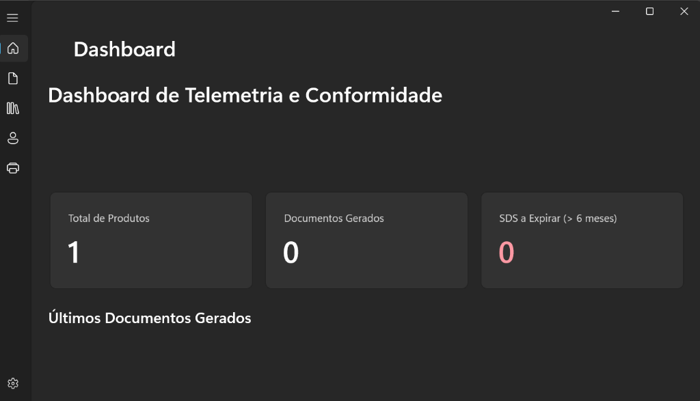
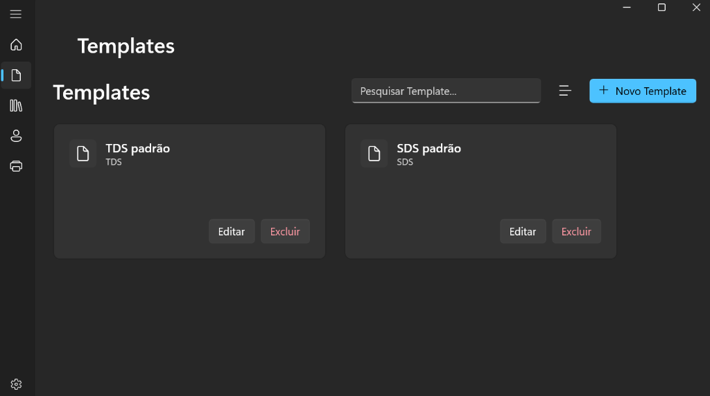
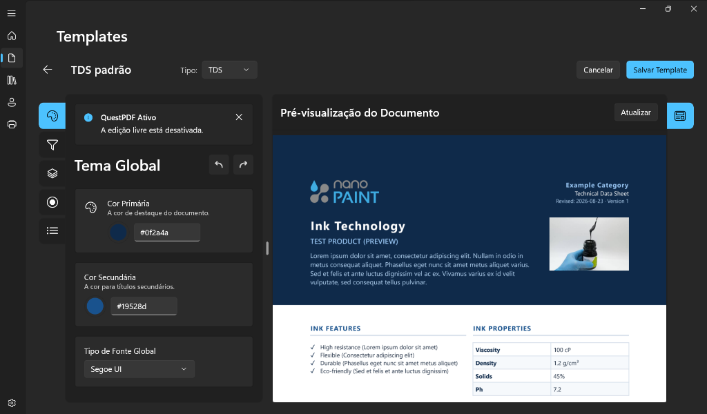
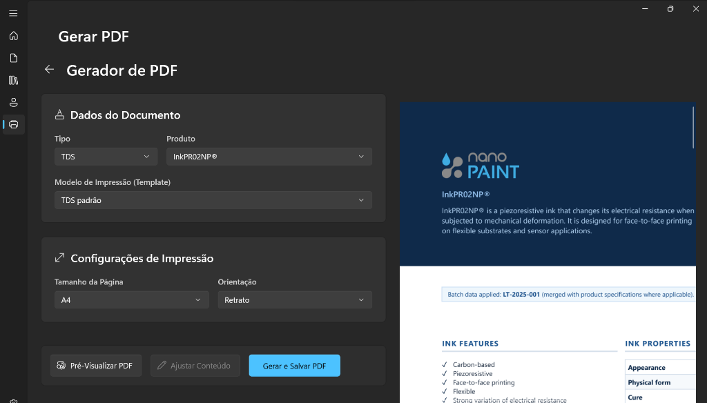
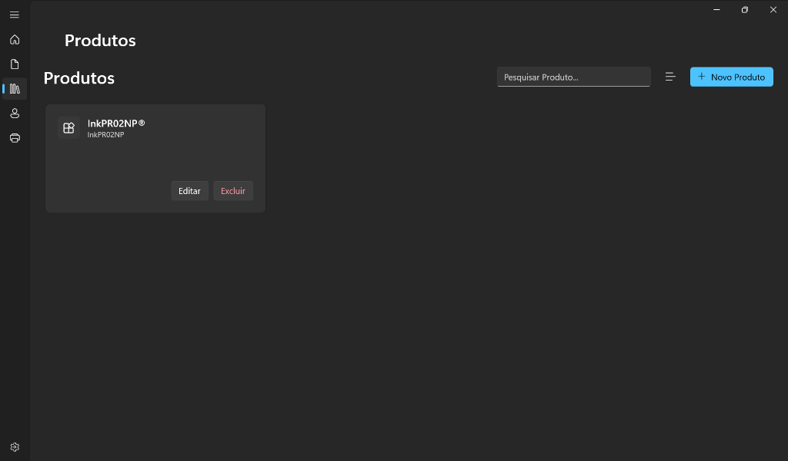
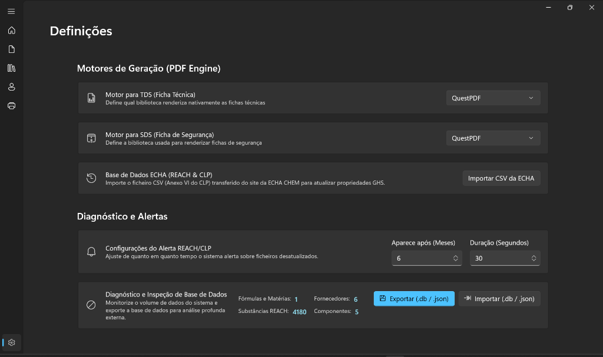
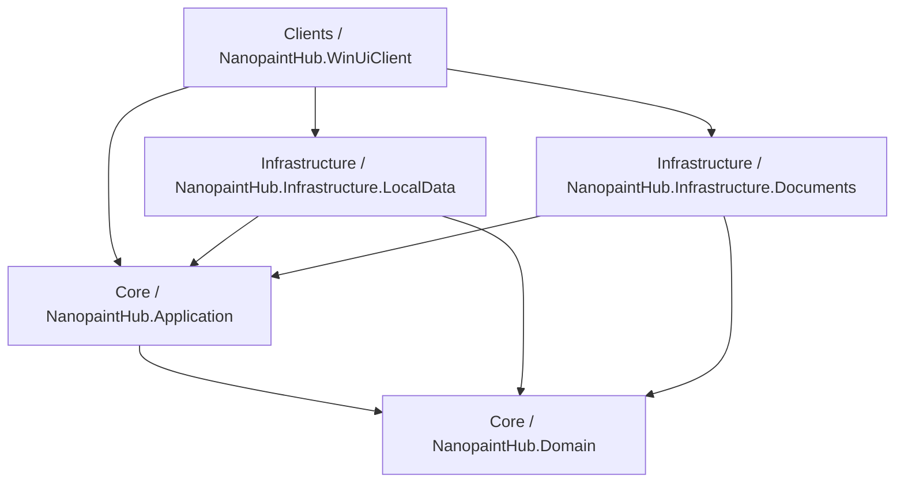

# NanopaintHub — TDS & SDS Generator

<div align="center">


### Sistema Industrial para Engenharia de Fichas Técnicas (TDS) e Fichas de Dados de Segurança (SDS)

[](https://github.com/joaquim1295/NanopaintHub---TDS-SDS-Generator/actions/workflows/ci-cd-build-and-release.yml)
[](https://github.com/joaquim1295/NanopaintHub---TDS-SDS-Generator/releases)
[](https://dotnet.microsoft.com/)
[-blue.svg)](https://microsoft.com/windows)
[](https://learn.microsoft.com/windows/apps/winui/winui3/)
[](Tests/NanopaintHub.UnitTests)

</div>

---

## 📖 Visão Geral

O **NanopaintHub** é uma solução corporativa para ambiente Windows desktop desenvolvida para a **Nanopaint**, vocacionada para a gestão e especificação de tintas funcionais avançadas (tintas piezorresistivas, condutivas de prata, grafeno e sensores flexíveis).

O software unifica o ciclo de vida da documentação técnica e regulamentar da empresa, eliminando a dependência de processos manuais ou ferramentas frágeis através de:
1. **Geração Automatizada de TDS (*Technical Data Sheet*):** Fichas técnicas com formatação padronizada, tabelas de propriedades líquidas, mecânicas e elétricas, gráficos de calibração SVG de alta fidelidade e importação direta de curvas via ficheiro CSV/Excel.
2. **Motor de Conformidade para SDS (*Safety Data Sheet*):** Fichas de segurança alinhadas com o regulamento europeu **REACH** e **CLP (Regulamento UE 2020/878)**, com cálculo automático de perigos com base nas formulações dos produtos e na base de dados química da **ECHA (Anexo VI)**.
3. **Editor Visual Híbrido (WYSIWYG):** Construtor de templates interativo com motor TinyMCE em processo isolado (*out-of-process Chromium* via PuppeteerSharp), que protege a estabilidade da aplicação sem depender de WebViews locais instáveis.

---

## 📸 Interface da Aplicação

<div align="center">

| **Dashboard de Telemetria e Conformidade** | **Catálogo e Gestão de Templates TDS/SDS** |
|:---:|:---:|
|  |  |
| *Métricas em tempo real, total de formulações e alertas de revisão regulamentar (>6 meses).* | *Templates canónicos prontos a usar e clonagem para versões customizadas.* |

| **Editor Visual de Ficha Técnica (TDS)** | **Gerador e Pré-visualização de PDF** |
|:---:|:---:|
|  |  |
| *Customização de secções, margens de segurança A4, cores institucionais e logos.* | *Compilação em tempo real com motor Chromium headless e download imediato.* |

| **Catálogo de Produtos e Formulações** | **Gestor de Substâncias e Perigos ECHA** |
|:---:|:---:|
|  |  |
| *Gestão de especificações dinâmicas, propriedades e lotes de fabrico.* | *Classificação oficial de substâncias químicas, frases H/P e consulta por CAS/EC.* |

</div>

---

## ⚙️ Principais Funcionalidades

### 📄 1. Engenharia de TDS (Fichas Técnicas)
* **Estrutura Modular:** Blocos de apresentação, tabelas de características mecânicas e líquidas, instruções de processamento (telas de serigrafia, cura, substratos como PET, PI, TPU) e condições de armazenamento.
* **Curvas de Desempenho e Gráficos:** Geração de gráficos vetoriais nativos (SVG) de resposta tensão/deformação, histerese e resistência elétrica, com suporte a importação direta de lotes de ensaio laboratoriais (.csv).
* **Margens de Impressão Seguras:** Normalização de cabeçalhos e rodapés repetíveis com compensação precisa de margens de segurança A4 (24pt / ~8.5mm).

### 🧪 2. Motor Normativo SDS (Regulamento REACH / CLP)
* **Base de Dados ECHA Integrada:** Consulta rápida de substâncias pelo número CAS ou EC Number com mapeamento automático de perigos (frases H e P).
* **Composição Química Declarada:** Cálculo das percentagens ponderadas de solventes e componentes ativos em cada produto final.
* **Geração Conforme o Anexo II:** Saída de 16 secções normativas prontas para revisão e carimbo do responsável químico.

### 🔀 3. Roteamento Multi-Motor de PDF (Strategy Pattern)
* **Chromium / PuppeteerSharp:** Motor prioritário para TDS criativos com HTML5, CSS Paged Media e templating Handlebars.
* **QuestPDF:** Motor fluente nativo C# para documentos densos, matrizes e tabelas com precisão tipográfica.
* **iText7 pdfHTML:** Motor corporativo para validação e processamento em lote.

### 💾 4. Armazenamento Local Seguro (Zero-Cloud Dependency)
* **Base de Dados SQLite Local:** Armazenada em `%LocalAppData%\NanopaintHub\nanopaint.db`. Permite operação local completa em PCs de bancada ou laboratório sem necessidade de servidor permanente.
* **Auto-Sementeira Canónica:** Se a base for inicializada pela primeira vez, o ficheiro de semente canónico `nanopaint.initial.db` preenche automaticamente a base com os templates padrão (`TDS padrão`, `SDS padrão`) e catálogo inicial.

---

## 🏛️ Arquitetura do Software

O projeto segue os princípios da **Clean Architecture** e **Domain-Driven Design (DDD)**:



### Divisão de Projetos

| Projeto | Camada | Responsabilidade |
|:---|:---:|:---|
| **`NanopaintHub.Domain`** | Core | Entidades de negócio (`Product`, `DocumentTemplate`, `EchaSubstance`, `TestBatch`), enums e contratos de repositório. |
| **`NanopaintHub.Application`** | Core | Casos de uso (`GenerateTdsUseCase`, `GenerateSdsUseCase`), geradores HTML/Handlebars, validações e DTOs. |
| **`NanopaintHub.Infrastructure.LocalData`** | Infra | Contexto EF Core SQLite (`NanopaintHubDbContext`), migrações, Unit of Work e `DatabaseSeeder`. |
| **`NanopaintHub.Infrastructure.Documents`** | Infra | Roteador de PDF, gerador Puppeteer/Chromium, QuestPDF, motor de layout e serviço TinyMCE. |
| **`NanopaintHub.WinUiClient`** | Apresentação | Aplicação nativa WinUI 3 com Windows App SDK, ViewModels MVVM Toolkit, páginas XAML e navegação fluida. |
| **`NanopaintHub.UnitTests`** | Testes | Suite de 32 testes unitários cobrindo persistência, repositórios, integridade de templates e geração de documentos. |

---

## 🚀 Instalação e Execução

### Opção 1: Instalador Oficial (Recomendado para Utilizadores)

1. Aceda à secção de [Releases do Repositório](https://github.com/joaquim1295/NanopaintHub---TDS-SDS-Generator/releases).
2. Transfira o ficheiro executável mais recente: **`NanopaintHub_Setup_v1.0.exe`**.
3. Execute o assistente de instalação (disponível em Português e Inglês).
4. O programa será instalado e criará os atalhos no **Ambiente de Trabalho** e **Menu Iniciar**.

---

### Opção 2: Compilação Local (Para Desenvolvedores)

#### Pré-requisitos
* **Windows 10 (versão 1809+) ou Windows 11 (x64)**
* **[.NET 9 SDK](https://dotnet.microsoft.com/download/dotnet/9.0)** e **[.NET 8 SDK](https://dotnet.microsoft.com/download/dotnet/8.0)**
* **[Inno Setup 6](https://jrsoftware.org/isdl.php)** *(necessário apenas se pretender compilar o instalador `.exe`)*

#### Passos para Clonar e Executar

```powershell
# 1. Clonar o repositório
git clone https://github.com/joaquim1295/NanopaintHub---TDS-SDS-Generator.git
cd NanopaintHub---TDS-SDS-Generator

# 2. Restaurar pacotes e dependências
dotnet restore NanopaintHub.sln

# 3. Executar os testes unitários
dotnet test Tests/NanopaintHub.UnitTests/NanopaintHub.UnitTests.csproj

# 4. Iniciar a aplicação em modo de desenvolvimento
dotnet run --project Clients/NanopaintHub.WinUiClient/NanopaintHub.WinUIClient.csproj
```

#### Gerar o Instalador Executável Localmente

Para compilar a aplicação em modo *Release Self-Contained* e gerar o setup oficial num único passo:

```powershell
.\scripts\build_installer.ps1
```

O instalador compilado será gerado na pasta `Publish/Installer/NanopaintHub_Setup_v1.0.exe`.

---

## 🔄 CI/CD e Esteira Automatizada (GitHub Actions)

O repositório possui uma pipeline completa de Integração e Entrega Contínua configurada em [.github/workflows/ci-cd-build-and-release.yml](.github/workflows/ci-cd-build-and-release.yml).

### Fluxo de Trabalho Automático:
* **Em cada Push/Pull Request:** Restaura o código num nó limpo Windows, executa os 32 testes unitários e compila os binários em modo Release.
* **Geração de Release com Tag:** Ao enviar uma tag de versão (ex: `git tag v1.0.1 && git push origin v1.0.1`), a esteira:
  1. Compila a aplicação com o Windows App SDK Runtime embutido;
  2. Executa o Inno Setup Compiler para produzir o `NanopaintHub_Setup_v1.0.exe`;
  3. Cria automaticamente uma **Release oficial no GitHub** anexando o instalador para download público.

---

## ⚖️ Conformidade e Aviso Legal

> **Aviso Regulamentar:** As Fichas de Dados de Segurança (SDS) e Fichas Técnicas (TDS) geradas por este software constituem ferramentas de apoio à engenharia e automação documental. A conformidade regulamentar perante as autoridades europeias (ECHA, REACH e CLP) exige sempre a validação e homologação técnica por parte de um profissional químico qualificado antes da comercialização do produto.

---

## 👥 Autoria e Direitos

* **Projeto:** NanopaintHub — TDS & SDS Generator
* **Desenvolvido para:** [Nanopaint](https://nanopaint-tech.com/)
* **Tecnologias:** C# 13, .NET 9, WinUI 3, Windows App SDK, SQLite, QuestPDF, PuppeteerSharp, Inno Setup 6.
